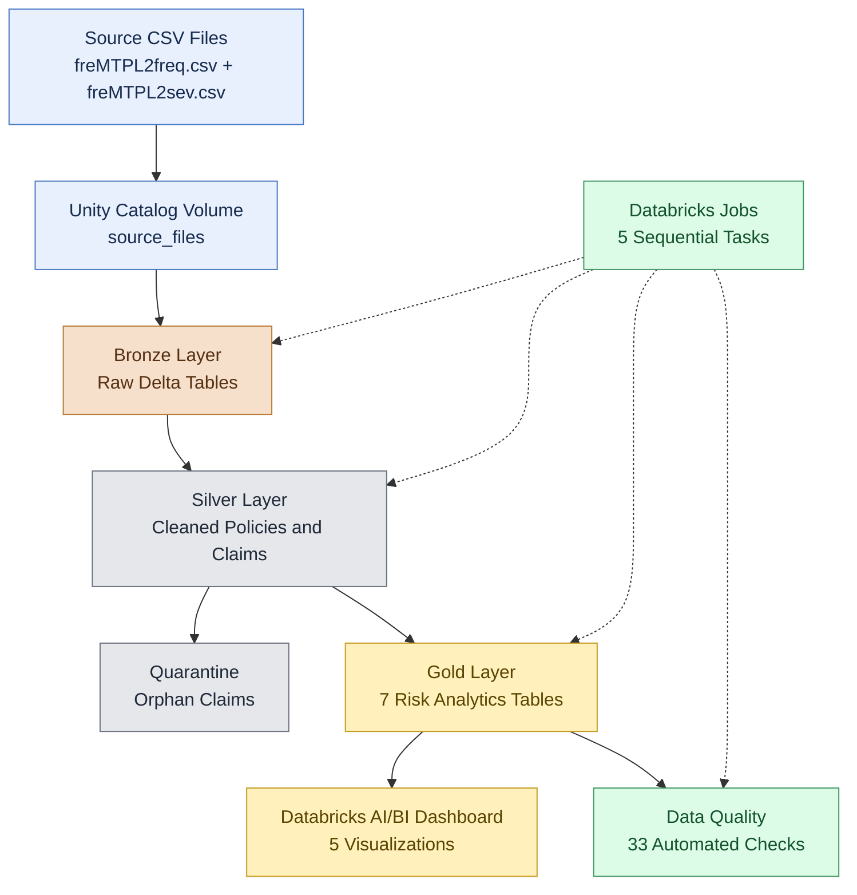
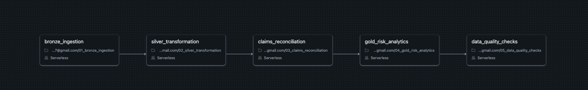
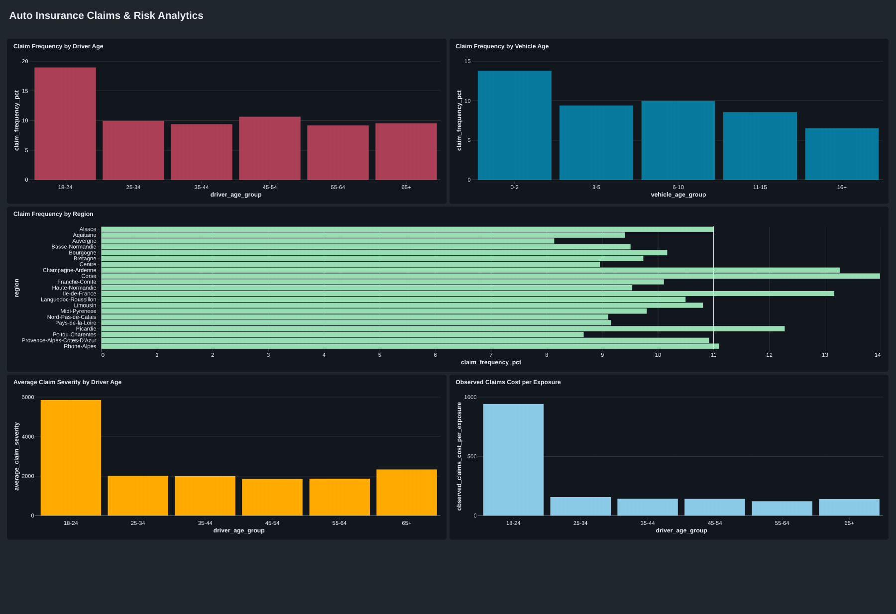

# Auto Insurance Claims & Risk Data Platform

An end-to-end data engineering project built with **Databricks, Apache Spark, Delta Lake, and Unity Catalog**, implementing a Medallion Architecture to process automobile insurance policy and claims data.

The platform transforms raw insurance datasets into validated analytical tables, orchestrates the processing workflow, and supports interactive risk analytics through a Databricks AI/BI Dashboard.

## Project Overview

The project demonstrates a complete data engineering workflow:

- Ingest raw CSV datasets into Delta Lake.
- Clean and standardize insurance policy and claims data.
- Validate referential integrity between policies and claims.
- Reconcile reported claim counts with available financial claim records.
- Build analytical Gold tables for insurance risk analysis.
- Execute automated data quality checks.
- Orchestrate the pipeline using Databricks Jobs.
- Visualize risk metrics using a Databricks SQL dashboard.

## Technology Stack

| Technology | Purpose |
|---|---|
| Databricks Free Edition | Development and execution environment |
| Apache Spark / PySpark | Distributed data processing |
| Spark SQL | Data transformation and analytical queries |
| Delta Lake | Transactional data storage |
| Unity Catalog | Data organization and governance |
| Databricks Jobs | Workflow orchestration |
| Databricks AI/BI Dashboards | Analytical visualization |
| GitHub | Source control and project documentation |

## Data Sources

The project uses the publicly available **freMTPL2** automobile insurance datasets from the Hugging Face repository `mabilton/fremtpl2`.

- `freMTPL2freq.csv`: Policy characteristics, exposure, and reported claim counts.
- `freMTPL2sev.csv`: Financial claim amounts associated with policies.

The original datasets are stored in a Unity Catalog Volume:

`/Volumes/auto_insurance/bronze/source_files/`

The source data is not included in this GitHub repository.

## Data Architecture





The platform follows the **Medallion Architecture**, separating data processing into three layers.

### Bronze — Raw Ingestion

Raw CSV files are loaded into managed Delta tables.

Tables:
- `auto_insurance.bronze.policies_raw`
- `auto_insurance.bronze.claims_raw`

Ingestion metadata includes:
- `ingestion_timestamp`
- `source_file`
- `batch_id`

**Loading strategy:** Full snapshot ingestion. Each execution reads the complete CSV datasets and overwrites the corresponding Bronze tables.

### Silver — Cleaned and Validated Data

The Silver layer applies data type conversions, standardized column names, and data validation rules.

Tables:
- `auto_insurance.silver.policies`
- `auto_insurance.silver.claims`
- `auto_insurance.silver.claims_orphan`

Claims referencing nonexistent policies are isolated in a quarantine table rather than silently discarded.

### Gold — Risk Analytics

The Gold layer contains seven analytical Delta tables:

| Table | Analytical Purpose |
|---|---|
| `risk_by_driver_age` | Claim frequency by driver age |
| `risk_by_vehicle_age` | Claim frequency by vehicle age |
| `risk_by_region` | Regional claim frequency |
| `severity_by_driver_age` | Average claim severity by driver age |
| `risk_by_vehicle_power` | Claim frequency by vehicle power |
| `risk_by_vehicle_fuel` | Claim frequency by vehicle fuel type |
| `claims_cost_by_driver_age` | Observed claims cost per unit of exposure |

These tables provide curated data for SQL analytics and dashboards.

## Data Reconciliation

The project explicitly reconciles reported policy claim counts against available financial claim records.

| Metric | Result |
|---|---:|
| Insurance policies | 678,013 |
| Reported claims | 36,102 |
| Valid financial claim records | 26,444 |
| Orphan financial claim records | 195 |
| Difference between reported and valid financial claims | 9,658 |
| Policies with claim-count discrepancies | 9,117 |

These differences are treated as documented source-data limitations rather than automatically interpreted as pipeline failures.

**Metric interpretation:**
- Claim frequency uses reported claim counts divided by exposure.
- Average severity uses available valid financial claim amounts.
- Observed claims cost per exposure uses recorded valid claim amounts and should not be interpreted as ultimate expected insurance loss cost.

## Automated Data Quality

The pipeline includes **33 automated data quality checks**, covering:

- Completeness and uniqueness
- Valid data types and business constraints
- Policy-to-claim referential integrity
- Bronze-to-Silver record reconciliation
- Gold-to-Silver analytical reconciliation
- Critical pipeline validation

**Validation outcome: 33/33 checks passed.**

Critical failures raise an exception to prevent the workflow from being reported as successful when validation fails.

Known discrepancies in the source datasets are monitored separately.

## Pipeline Orchestration

The Databricks Job `auto_insurance_data_pipeline` executes five notebook tasks sequentially:

1. `bronze_ingestion`
2. `silver_transformation`
3. `claims_reconciliation`
4. `gold_risk_analytics`
5. `data_quality_checks`

The workflow runs on Databricks serverless compute and has completed successfully.

The environment setup notebook is maintained separately.

### Databricks Job Workflow

The data pipeline is orchestrated using Databricks Jobs with five sequential tasks running on serverless compute.



## Analytics Dashboard

The Databricks AI/BI dashboard **Auto Insurance Claims & Risk Analytics** provides five visualizations:

1. Claim Frequency by Driver Age
2. Claim Frequency by Vehicle Age
3. Claim Frequency by Region
4. Average Claim Severity by Driver Age
5. Observed Claims Cost per Exposure



### Selected Analytical Findings

- Drivers aged 18–24 have a reported claim frequency of approximately **18.93%**.
- Vehicles aged 0–2 years have a reported claim frequency of approximately **13.77%**.
- The observed claims cost per unit of exposure for drivers aged 18–24 is approximately **940.12** in the dataset's monetary units.

These results are descriptive metrics derived from the supplied datasets and should not be interpreted as causal relationships.

## Repository Structure

```text
auto-insurance-data-platform/
├── notebooks/
│   ├── 00_setup_environment.ipynb
│   ├── 01_bronze_ingestion.ipynb
│   ├── 02_silver_transformation.ipynb
│   ├── 03_claims_reconciliation.ipynb
│   ├── 04_gold_risk_analytics.ipynb
│   └── 05_data_quality_checks.ipynb
└── README.md
```

## Running the Project

1. Set up a Databricks workspace with Unity Catalog support.
2. Create the `auto_insurance` catalog and the `bronze`, `silver`, and `gold` schemas.
3. Upload the source CSV files to the configured Unity Catalog Volume.
4. Import the notebooks into Databricks.
5. Run `00_setup_environment` to configure the environment.
6. Execute the remaining notebooks in sequence, or configure the five-task Databricks Job.
7. Review data quality results and query the Gold tables.
8. Create the dashboard using the Gold analytical tables.

The pipeline currently uses full snapshot processing. Incremental ingestion is not implemented.

## Future Enhancements

- Incremental data ingestion using Delta Lake.
- Delta `MERGE` operations for inserts and updates.
- Change Data Feed for change tracking.
- Idempotent batch processing and deduplication.
- Incremental Gold table maintenance.
- Additional automated monitoring and operational reporting.

## Project Purpose

This project was developed as a hands-on data engineering portfolio project to demonstrate data ingestion, transformation, reconciliation, quality assurance, orchestration, and analytical data modeling using the Databricks ecosystem.
